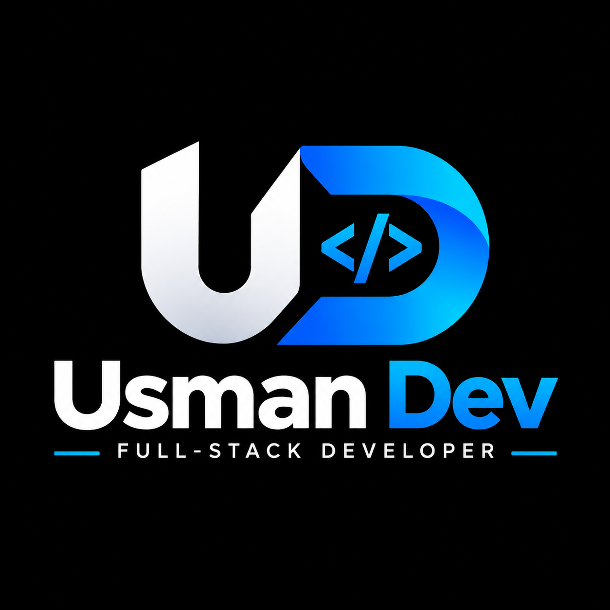
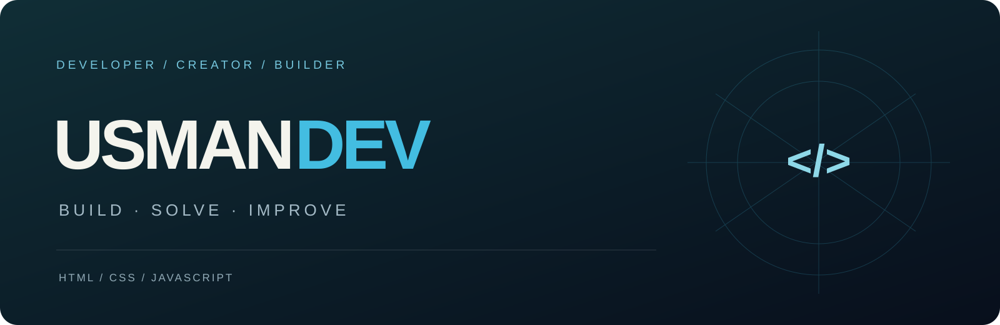
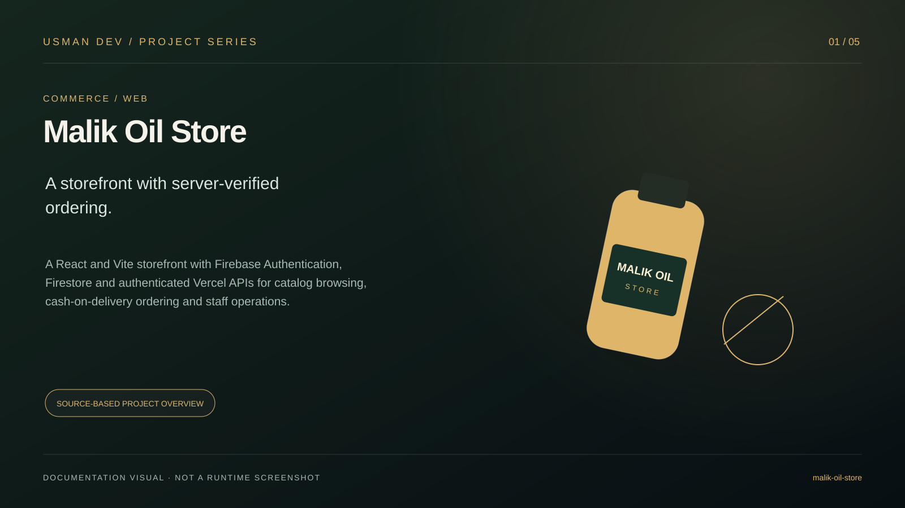
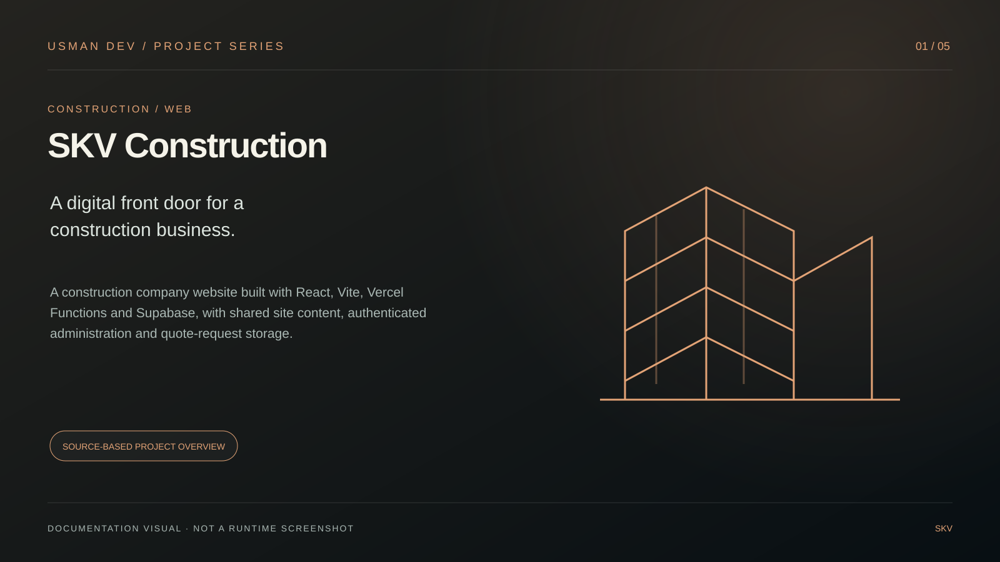
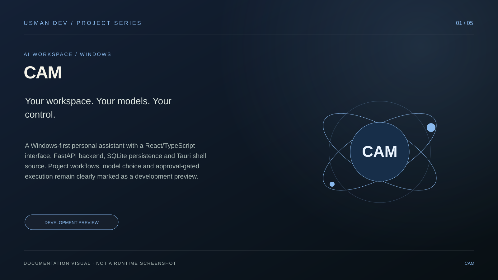
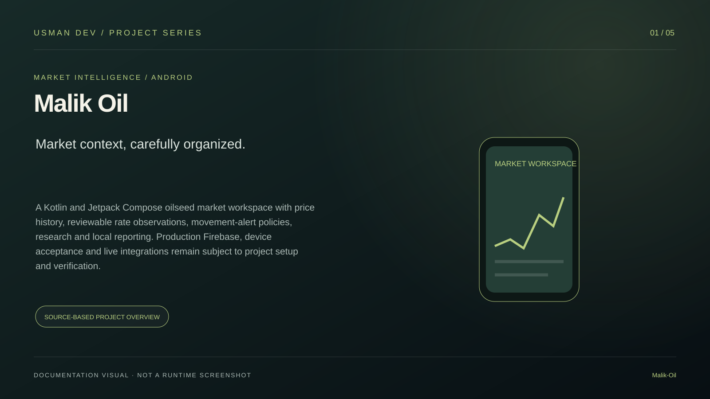

<p align="center"></p>

# Usman Dev — Developer Portfolio

A responsive personal portfolio built with **HTML, CSS and JavaScript**. Explore project galleries, skills and the work behind each door. Includes a form-based Portfolio Studio for keeping content up to date.



## Features

- Cream-to-dark introduction, animated notebook role card and original owner branding.
- Four interactive project doors, including **Video Editing**.
- Four real GitHub projects with **five original visual guides each**.
- Data-driven skills, profile links and experience chapters.
- Email, WhatsApp, Facebook and GitHub contact links.
- Portfolio Studio: add/edit/remove projects and skills, preview a browser draft, import/export JSON and download updated content.
- Keyboard navigation, responsive layouts, accessible labels and reduced-motion support.
- Static hosting: no server, database or runtime dependency required.

## Project visuals

These are original source-based documentation illustrations, not screenshots of running applications.

| Malik Oil Store | SKV Construction |
| --- | --- |
|  |  |

| CAM — development preview | Malik Oil — Android workspace |
| --- | --- |
|  |  |

Each project's `dist/images/projects/` folder includes overview, features, architecture, workflow and technology visuals.

## Run locally

Open `dist/index.html` in a browser. For draft preview and consistent browser storage, serve the folder locally:

```sh
python -m http.server 4173 --directory dist
```

Open `http://localhost:4173`. No package installation is required. Optional source validation uses Node.js 20 or later:

```sh
npm run check
```

## Update your portfolio

Open `/editor.html` for Portfolio Studio. Edit your profile, add project live/GitHub/image links and update your skills.

**Save draft stores changes only in that browser.** Draft preview is private to that browser's storage; it does not update the public website. Download `content.js`, replace `dist/content.js` in this repository, and push to the production branch to publish through the connected Vercel project. Use JSON backup/import to move a draft to another device.

You can also edit `dist/content.js` directly. All personal details, links, projects, skills and timeline entries live in that one file. Project `gallery` arrays reference the five-image guides. Local image paths must start with `images/`; external image URLs must use HTTP or HTTPS.

## Deploy on Vercel

Import this repository, select the **Other** framework preset and use the repository root. The included `vercel.json` serves the `dist` directory without build or install steps. Production Git deployments publish the configured production branch.

The requested `usmandev.vercel.app` address was already in use by another account when checked; the final assigned production address is recorded after deployment.

## Source map

```text
dist/
  index.html          Portfolio
  content.js          Editable content
  app.js              Portfolio interactions
  style.css           Reference-inspired layout
  personalized.css    Branding, skills and galleries
  editor.html         Portfolio Studio
  editor.js           Browser draft and export workflows
  editor.css          Studio styles
  images/projects/    Twenty original SVG visual guides
docs/images/          Profile banner
scripts/check.mjs     Dependency-free source/asset validation
vercel.json           Static deployment configuration
```

## Contact

[GitHub](https://github.com/MalikUsmanAbid) · [Email](mailto:usmandev234@gmail.com) · [WhatsApp](https://wa.me/923157543808) · [Facebook](https://www.facebook.com/profile.php?id=61594398140960)

Owner photography, logo, branding and original visual guides belong to Usman Dev. No third-party project licenses are changed by this portfolio repository.
